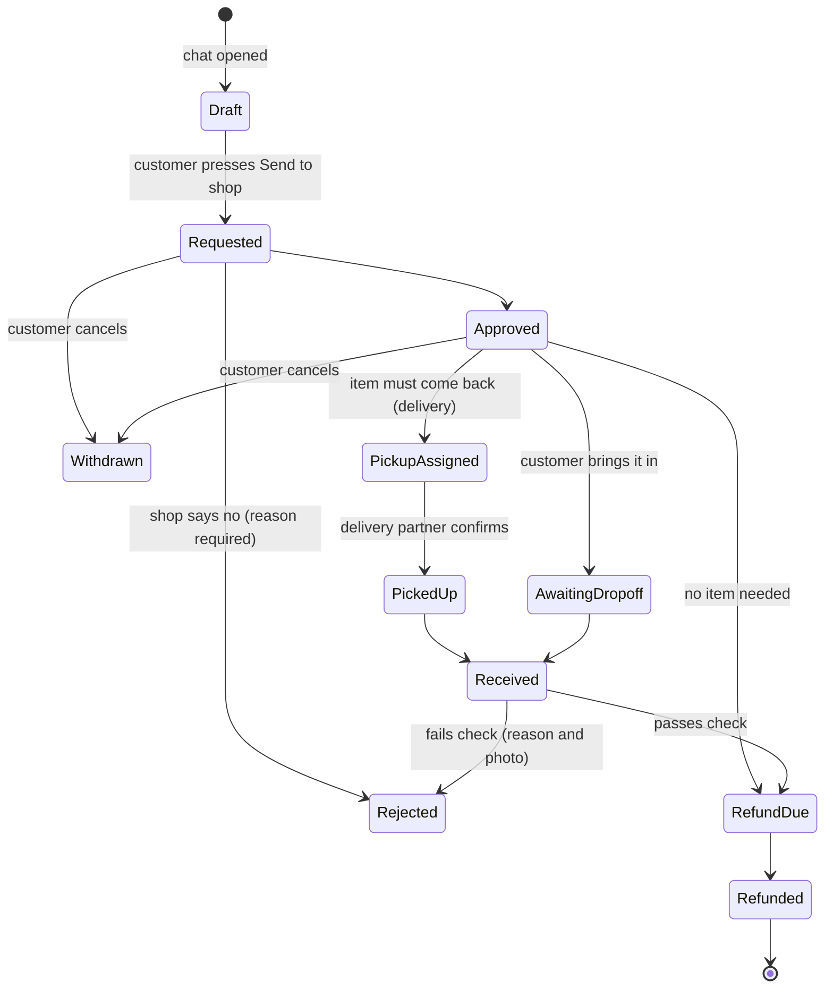

# Order returns: design proposal

Status: **proposal, nothing built yet** · 26 November 2026 · Applies to TanyRetail and TanyEats orders · Returns are handled **as a chat** between the customer and the shop

## 1. Today

| Area | What exists |
|---|---|
| Order states | `pending_payment → new → confirmed → preparing → ready / out_for_delivery → completed`, or `cancelled` |
| After `completed` | A review only. No return, complaint or partial refund |
| Online refunds | Automatic on cancel, **full order total only** (`refundOrder` in `lib/restaurant/payments.ts`) |
| Cash orders | Staff can mark paid or unpaid. No record of money given back |
| Stock | Put back automatically on cancel (`cancelAndRestock`) |
| Who may refund | Owner only (`canRefund`) |

## 2. Principles

1. **A return is its own record, not an order status.** The order stays `completed`. One order can have several returns, each for some of its items.
2. **Items first.** Customers pick items and quantities. The system works out the money; nobody types a refund amount by default.
3. **Never refund more than was paid**, across all returns on an order.
4. **Stock comes back only if the shop says the item can be sold again.**
5. **Perishables need not travel back.** The shop can refund and let the customer keep or discard the item.
6. **Only the owner releases money.** Staff can review, arrange pickup and check items.
7. **One conversation per return.** Automatic replies collect the facts; the customer can type at any time; a person at the shop decides.

## 3. Return states



Money has its own state on the same record: `not due → due → sending → sent → confirmed`, or `failed`. A failed refund stays visible until someone fixes it. This mirrors how cancellation refunds already recover.

## 4. Default rules (each shop can change them)

| Rule | Proposed default |
|---|---|
| Returns on or off | Off until the owner turns it on |
| Window, counted from delivery or handover | Per category: **24 hours** for fresh and chilled food, **3 days** for everything else |
| Categories that cannot be returned | Owner ticks them (for example opened personal care) |
| Reasons | Damaged · Wrong item · Missing item · Expired or spoiled · Quality not as expected · Changed my mind (off by default) |
| Photo | Required for damaged, wrong, and expired or spoiled. Up to 3 |
| Missing item | No pickup, straight to review |
| Restaurants | Missing, wrong or spoiled only; never a physical pickup |
| Approval | Manual. Auto-approval below an amount can come later |
| Reply time shown to the customer | "The shop usually replies within 24 hours" |

## 5. Refund amount

For the chosen quantity of each line:

`item value − its share of the coupon discount + its share of GST`, summed, then rounded **down** to whole rupees.

- Shares are in proportion to each line's value.
- The return that completes a whole-order return takes any rounding remainder, so the parts never differ from what was paid.
- **Delivery fee:** returned only when the shop is at fault **and** the whole order is returned.
- **Tip:** never taken back from the delivery partner.
- **Changed my mind:** no delivery fee. A pickup charge is not proposed for the first version.
- The owner may lower or raise the amount with a written reason, never above what remains paid. The customer sees the reason.
- **Coupon:** it stays used. A later minimum-order rule is not applied backwards.

**Example:** items ₹200 and ₹100, coupon −₹30, GST ₹14, delivery ₹25, paid ₹309. Returning the ₹100 item: ₹100 − ₹10 + ₹4.67 = **₹94**.

### How the money goes back

| Paid by | Method |
|---|---|
| Online (Razorpay) | Partial refund to the original payment method, sent when the owner presses **Refund** |
| Cash | The shop pays by cash or UPI and records method, amount, date and an optional reference. The customer sees "Paid back by the shop" |

Store credit and replacement are **not** in the first version. A replacement can be handled as a refund plus a new order.

## 6. The return chat: customer side

Entry points: **Report a problem or return** on the order page (`/o/[code]`) and in "My orders". It opens a chat tied to that order: full screen on a phone, a side panel on desktop.

**Who can open it:** only a signed-in customer whose verified phone matches the order's. The order link alone is not enough, because anyone it is forwarded to can open it. A guest is asked to sign in with the number used on the order.

### 6.1 What the chat looks like

```
Return help · Order K7X2MQ · Sellers hypermarket
--------------------------------------------------
BOT   Hi! I can help with order K7X2MQ, delivered
      today 10:42 am. What went wrong?
      [Damaged] [Wrong item] [Missing item]
      [Expired or spoiled] [Something else]

                              YOU  Expired or spoiled

BOT   Which item?   (items shown as cards with - 1 +)
      [x] Apple Shimla 1kg    [ ] Amul Butter 100g
      [Continue]

BOT   Please add a photo of the problem.  [ Add photo ]

                         YOU  [photo][photo]
                         YOU  Two were soft and brown

BOT   Here is your request:
      Apple Shimla 1kg x1 · Spoiled · 2 photos
      Estimated refund ₹169, to your original payment
      method. The shop decides.
      [Send to shop]  [Change]

BOT   Sent. Return R-4821. The shop usually replies
      within 24 hours.

SHOP  Sorry about that. No need to send them back.
      [Approved · refund ₹169]
--------------------------------------------------
[ + ]  Type a message...                    [Send]
```

The text box is **always** available.

### 6.2 Who is speaking

Every message is clearly marked **Assistant**, **Shop** or **You**. The assistant never pretends to be a person.

### 6.3 Automatic replies

Scripted, like the store's existing order assistant: no AI model, every reply built from the order's own data and the shop's rules. That makes replies predictable and testable.

| Moment | Automatic reply |
|---|---|
| Chat opens | Greeting, order summary, reason buttons |
| Reason chosen | Item cards; items that cannot be returned stay visible with why |
| Items chosen | Asks for a photo when the rule needs one |
| Ready | Summary with the estimated refund and **Send to shop** |
| Sent | Return number and expected reply time |
| First typed message that is not an answer | "I've saved this for the shop. They'll read it here." Said once, not after every message |
| Outside shop hours | Adds when the shop opens next |
| Outside the return window | Explains the window; the customer can still message the shop, but no return request is created |
| Shop approves, rejects, assigns pickup, receives or refunds | A status message with the details |
| "Where is my refund?" button | Current refund state, from the record |
| No shop reply after the promised time | "Still waiting for the shop. You can call them." with a **Call the shop** button. The shop is reminded too |

**The assistant never** approves or rejects a return, promises money or a date the shop has not set, or answers typed questions by guessing.

### 6.4 Free text

- Typing at the start is fine: the message is kept, and the assistant then offers the reason buttons. Typed text is not interpreted.
- After **Send to shop**, typed messages go straight to the shop, and the assistant stays quiet except for status updates.
- **Talk to the shop** is always offered, so nobody is stuck in the buttons. It sends the conversation to the shop even before a request is complete, marked **Needs help**.

### 6.5 Coming back

The conversation is saved. Leaving and reopening continues where it stopped. The order page shows "Shop replied" with an unread dot. After a return is refunded or rejected the chat stays readable; the customer can send one follow-up, which reopens it for the shop.

## 7. The return chat: shop side (admin)

**New menu item: Returns** (under Orders), with a count of conversations waiting for the shop.

### 7.1 Inbox

Three panels on desktop; on a phone, the list opens into the chat.

```
RETURNS        | R-4821 · Priya · K7X2MQ         | THIS RETURN
Waiting (3)    |--------------------------------| Waiting for you 35 min
> R-4821 ₹169  | Assistant  What went wrong?    | Apple Shimla 1kg x1
  "soft and.." | Customer   Spoiled             | Spoiled  [photo][photo]
  35 min  (2)  | Customer   [photo][photo]      |
  R-4819 ₹58   | Customer   Two were soft       | Paid online ₹418
  Needs help   |                                | Refund ₹169  [Change]
               | You        Sorry about that.   | ( ) Just refund
Open           |                                | ( ) Rider picks up
Done           | [Quick replies v]              | ( ) Customer drops off
               | [ + ] Reply...        [Send]   | [Approve] [Reject...]
```

- **Tabs:** Waiting for shop, Waiting for customer, Done. Sorted by longest waiting. Search by return, order or customer name.
- **Chat:** the whole conversation, including what the assistant said, so staff never ask twice. Text and photos.
- **Quick replies:** saved sentences the shop can edit ("Please send one more photo", "No need to send it back"). They fill the box; nothing is sent without pressing Send.
- **Actions panel:** the decisions. Approve, reject, choose how the item comes back, mark received, back to stock or discard, refund. **Typing "refunded" in the chat does nothing to money or status**; only these buttons do, and each posts its status message into the chat.
- **Call** and **WhatsApp** stay available.

### 7.2 Alerts

A new return, **Needs help**, or a customer's new message raises the same stacked popup, bell and sound used for orders. Messages from one conversation are grouped, not one alert each.

### 7.3 Elsewhere in the admin

- Order detail: a Returns box with each return, the net amount kept and **Open chat**.
- **Settings → Returns:** on/off, windows per category, non-returnable categories, reasons, photo rule, expected reply time, quick replies, policy text shown to customers.
- Dashboard and reports: sales **net of refunds**, return rate, top returned products and reasons, time to first shop reply.
- Payments: refunds listed with their state; failed ones highlighted.

### 7.4 Delivery of messages

First version: the open chat checks for new messages every few seconds, the inbox about every 20 seconds, and both stop while the tab is hidden. That is how order alerts already work and needs no new service. A live connection can replace it later. Messages show **Sent** or **Not sent · Retry**; there are no typing indicators or read receipts in the first version.

Customers see replies when they open the store. **There is no push, SMS or WhatsApp notification in the first version**, so a customer who closed the page will not be told automatically. The shop can use the WhatsApp button.

## 8. Delivery partner screens

A pickup appears in the rider's list, marked **Return pickup**, with the address, items and the shop's note. Actions: **Picked up** (optional photo), or **Could not collect** with a reason, which sends it back to the shop. Riders never see or hand over refund money in the first version.

## 9. Data

| Table | Main fields |
|---|---|
| `order_returns` | id, dealer_id, order_id, customer_id, code, bot step, needs_help, last message times, shop and customer read times, status, resolution (no item / pickup / drop-off), reason note, shop note, amount_requested, amount_approved, change_reason, refund_state, refund_method, refund_id, refund_error, refund_attempts, refund_ref, partner_id, timestamps per step |
| `order_return_lines` | return_id, order line position, item_id, name, quantity, unit price, line refund, reason, restock decision |
| `return_messages` | return_id, sender (customer / assistant / shop / system), staff user, text, attachment keys, status event, client message id (so a retry never posts twice), time |
| `return_media` | return_id, message_id, storage key |
| shop settings | the rules in section 4, with the policy text, reply time and quick replies |

A conversation exists before the request is complete, in a **Draft** state before Requested. A draft with no **Talk to the shop** is not shown to the shop and is deleted after 7 days. Status changes are written as system messages, so one timeline serves as chat and history. The audit log still records who did what.

Order lines have no ids today, so a return line stores the line's position and a copy of its name and price.

## 10. Safety and correctness (must be in the first build)

1. **Quantity guard:** inside one database transaction, returned quantity across open and finished returns can never exceed what was ordered.
2. **Money guard:** the sum of refunds can never exceed the amount paid. A full-order cancellation refund and a return can never both run.
3. **Refund key per return.** The Razorpay helper's default idempotency key is built from payment id and amount. Two returns of the **same amount** on one order would share it, and the second could be mistaken for the first. Each return must pass its own key.
4. **Verify partial refunds with Route in Razorpay test mode before launch.** The helper sends `reverse_all` for linked accounts. How this takes money back from the shop on a *partial* refund has not been checked.
5. **Record first, send second.** Mark the refund "sending" before calling Razorpay; a recovery job finishes or flags interrupted ones, as cancellation refunds do now.
6. **Payment status:** add "partly refunded". Existing reports and screens that assume paid or refunded must be reviewed.
7. **Privacy:** return notes, photos and phone numbers belong to the shop. They follow the existing per-shop sealing; Tany platform staff see counts, amounts and refund failures, not customer details. Photos need unguessable, shop-and-customer-scoped storage, and a deletion period (proposed: 180 days).
8. **Abuse:** rate limit requests, one open request per order, and show the shop the customer's recent returns. No automatic blocking.
9. **Audit:** every approval, amount change, rejection and refund records who did it.
10. **Chat is untrusted input:** messages are shown as plain text (links are not made clickable in the first version), limited in length (1,000 characters) and rate limited per customer. Attachments are photos only, checked on the server like review photos. Every read and send checks both the shop and the customer.
11. **No card or bank details in chat:** the box warns against sharing them. Cash paybacks are recorded through the form, not by asking in chat.
12. **Sent messages cannot be edited or deleted** by either side, so the record holds up in a dispute. The shop's retention period removes old conversations.

## 11. Build in phases

| Phase | Includes | Result |
|---|---|---|
| **1. Chat and decide** | Settings, scripted chat with free text and photos, shop inbox with quick replies, approve or reject, "no item needed", recording cash paybacks, alerts | The full conversation from customer to shop |
| **2. Online money** | Partial Razorpay refunds with the guards in section 10, recovery job, payments and report changes | Refunds from inside the app |
| **3. Physical returns** | Drop-off, delivery partner pickup, inspection, restock or discard | Full return cycle |
| **Later** | Live connection, WhatsApp or SMS updates, replacement, store credit, auto-approval, AI to suggest replies for staff to review | |

In phase 1, an online order's refund is made by the owner in the Razorpay dashboard and recorded here. The screen and the chat must not say the app sent the money.

Phase 1 reuses the store's chat components (`components/ui/message`, `bubble`, `message-scroller`, `attachment`), the scripted pattern of `lib/restaurant/order-bot.ts`, the photo checks used for reviews and the existing order alerts. It needs **new database tables**.

**For a demo:** phase 1 shows the whole customer-to-shop story without moving real money.

## 12. Decisions needed

| # | Question | Proposed |
|---|---|---|
| 1 | Default windows | 24 hours fresh and chilled, 3 days the rest |
| 2 | Allow "changed my mind"? | Off by default |
| 3 | Delivery fee refund | Only shop's fault and whole order |
| 4 | Who releases money | Owner only |
| 5 | Must customers sign in? | Yes, phone matching the order |
| 6 | What to build first | Phase 1 |
| 7 | Automatic replies | Scripted, no AI model |
| 8 | Chat only for returns? | Yes. General shop chat is a separate feature |

## 13. Not covered

Car sales and cab bookings; GST credit notes and accounting exports (ask an accountant what is required for refunds); legal wording of each shop's return policy, including consumer-protection duties.
